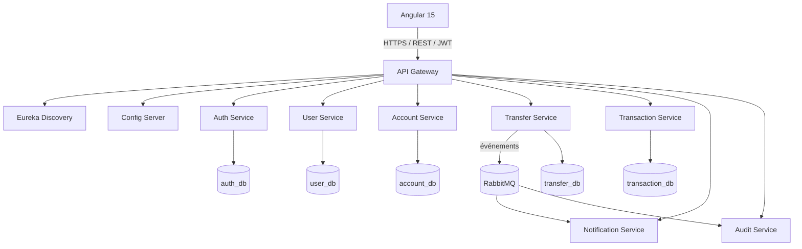

# Banking Management System — AhmedKH

Application web bancaire **fictive** à but pédagogique : inscription, authentification, comptes, bénéficiaires, virements simulés, historique, notifications et audit. Aucun paiement réel, aucune donnée personnelle réelle.

## Stack imposée

| Domaine | Choix |
| --- | --- |
| Backend | Java 17, Spring Boot 3, Spring Security, Spring Data JPA, Hibernate, Bean Validation |
| Microservices | Spring Cloud Gateway, Eureka Discovery Server, Spring Cloud Config |
| Frontend | Angular 15, TypeScript, RxJS |
| Données | PostgreSQL + Flyway, une base logique par service |
| Messagerie | RabbitMQ à partir du sprint 8 |
| Tests | JUnit 5, Mockito, MockMvc, Testcontainers, tests Angular |
| DevOps | Docker, Docker Compose, GitHub Actions |
| Cloud | AWS IAM/MFA/Budgets, VPC, EC2, ECR, RDS, S3, CloudWatch |

## Architecture cible



Règles fortes : chaque service a sa propre base, le Gateway n'est pas une couche de sécurité suffisante, les montants utilisent `BigDecimal`, le frontend n'est jamais source de vérité.

## Structure du dépôt

```text
.
├── frontend/                 # Angular 15
├── services/
│   ├── config-server/
│   ├── discovery-server/
│   ├── api-gateway/
│   ├── demo-service/             # service temporaire de test du Sprint 1
│   ├── auth-service/
│   ├── user-service/
│   ├── account-service/
│   ├── transfer-service/
│   ├── transaction-service/
│   ├── notification-service/
│   └── audit-service/
├── infrastructure/           # Docker, AWS, scripts
├── docs/                     # cahier des charges, diagrammes, API, guides
├── .github/workflows/        # CI GitHub Actions
├── docker-compose.yml        # Sprint 10
└── README.md
```

Package Java de base : `com.ahmedkh.banking` (ex. `com.ahmedkh.banking.account`).

## Git — travail quotidien

Branches : `main` (releases), `develop` (intégration), **une branche conservée par sprint** `sprint/XX-slug`, plus `feature/...`, `fix/...`, `docs/...`, `chore/...`.

```powershell
git switch develop
git pull origin develop
git switch -c sprint/02-auth
# une tâche = un commit
git commit -m "feat(auth): add register endpoint"
git switch develop
git merge --no-ff sprint/02-auth -m "Merge sprint/02-auth into develop"
git push origin develop sprint/02-auth
```

Messages : `feat`, `fix`, `docs`, `chore`, `refactor`, `test`, `build`, `ci`. Détail complet : [docs/git-workflow.md](docs/git-workflow.md).

## Prérequis (à valider avec la tâche 0.1)

- **JDK 17** : `java -version` doit afficher 17 (attention : une JDK 26 reste installée par défaut sur la machine ; un toolchain Temurin 17 a été utilisé pour les builds).
- **Maven 3.9+** : `mvn -version`. Chaque service contient aussi son Maven Wrapper (`mvnw` / `mvnw.cmd`) configuré sur 3.9.16.
- **Node 18.x** : Angular 15 ne prend pas en charge Node 24 installé actuellement (à corriger avant le Sprint 9).
- **Docker** : `docker --version`.
- Sur PowerShell Windows, si `npm` est bloqué par la politique d'exécution, utiliser `npm.cmd` ou `cmd /c npm`.

Lancer les fondations Spring Cloud : voir [docs/ports-and-services.md](docs/ports-and-services.md).

## Sprints

Feuille de route détaillée : [docs/sprint-plan.md](docs/sprint-plan.md). Statut actuel : **Sprint 1 terminé, Sprint 2 à démarrer**.

## Sécurité et qualité

- Frontend jamais source de vérité pour rôles, propriété d'un compte ou montant.
- Chaque service valide ses propres autorisations.
- Aucune base partagée entre services, aucun secret commité, aucun token dans les logs.
- `BigDecimal` uniquement pour l'argent, Saga + idempotence pour les virements.

Voir aussi : [architecture](docs/architecture-overview.md) · [ports et services](docs/ports-and-services.md) · [cahier des charges PDF](docs/Cahier_des_charges_Banking_Microservices_AhmedKH_v2_Sprints_Detailles.pdf).
